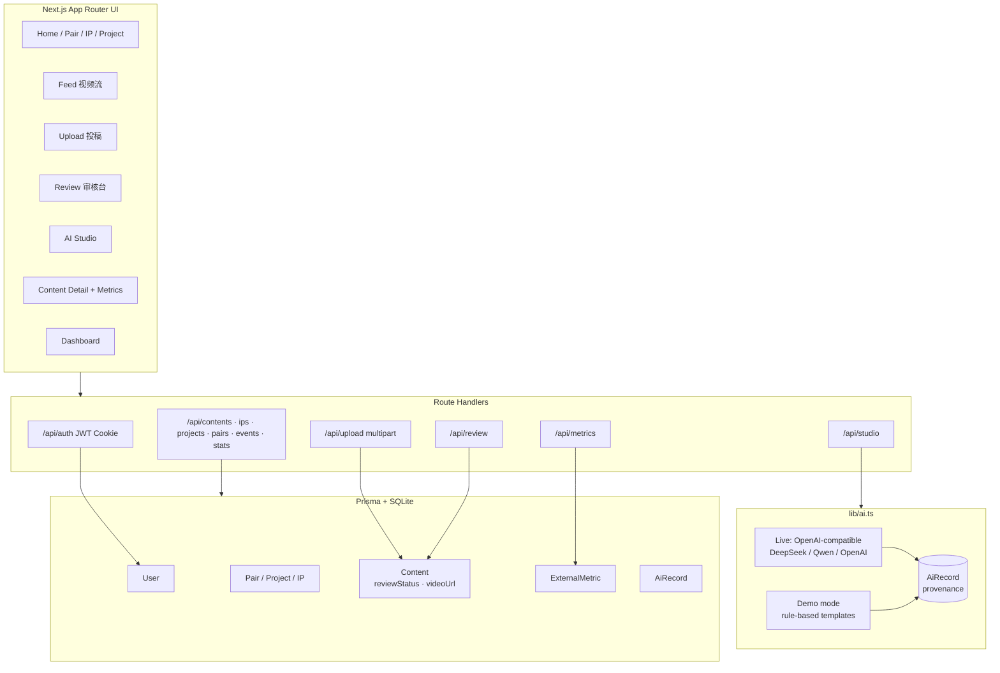
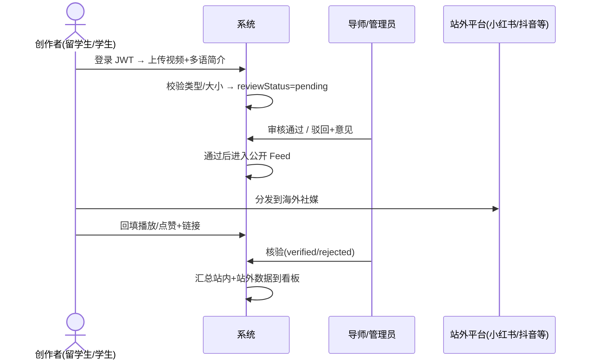
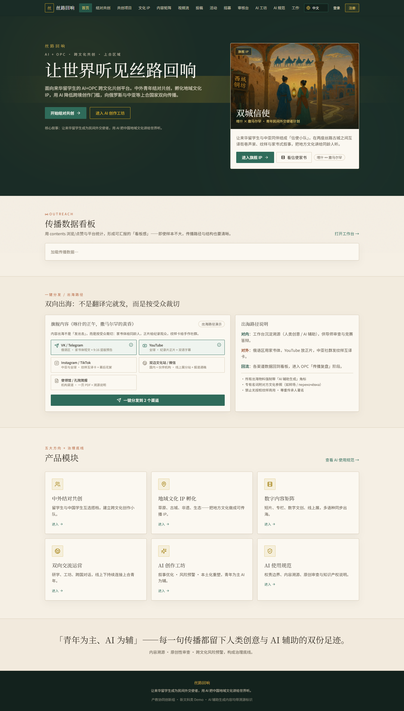
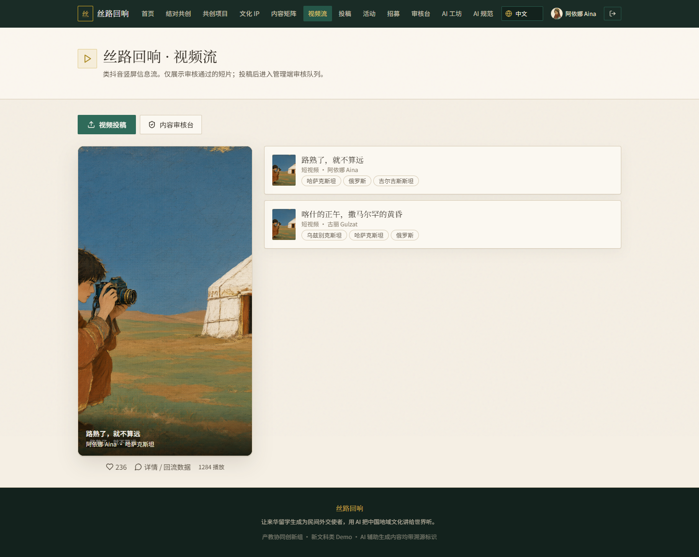
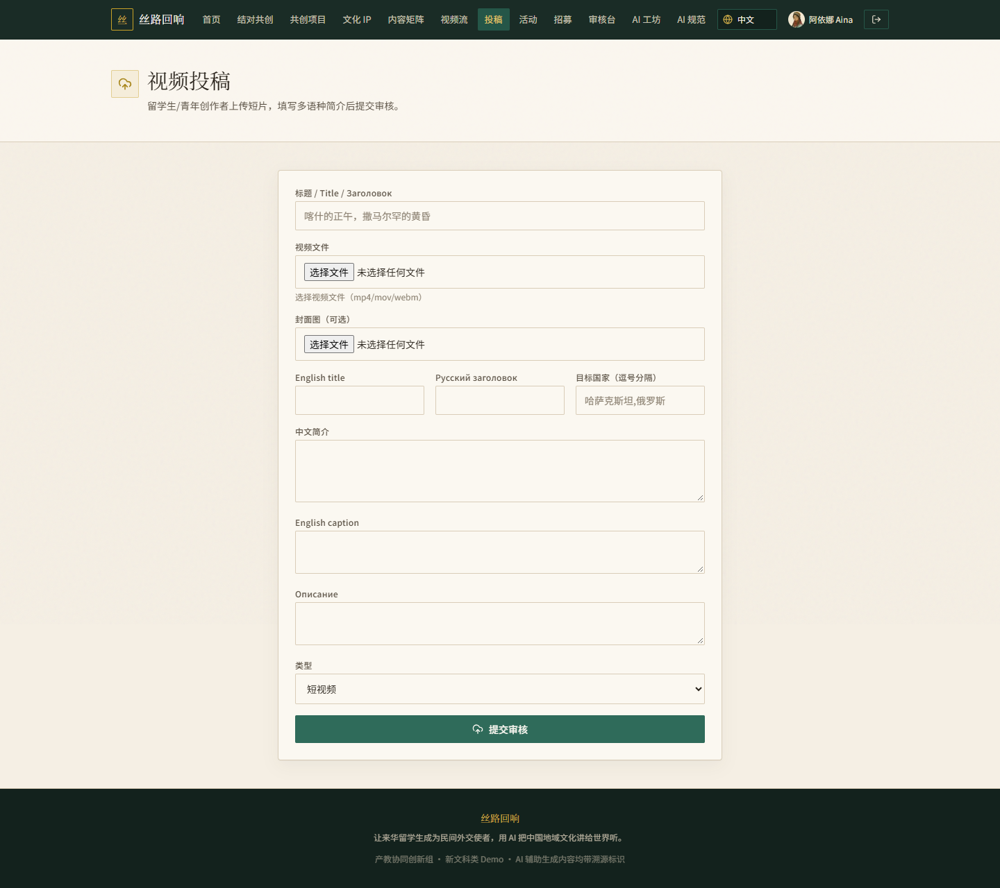
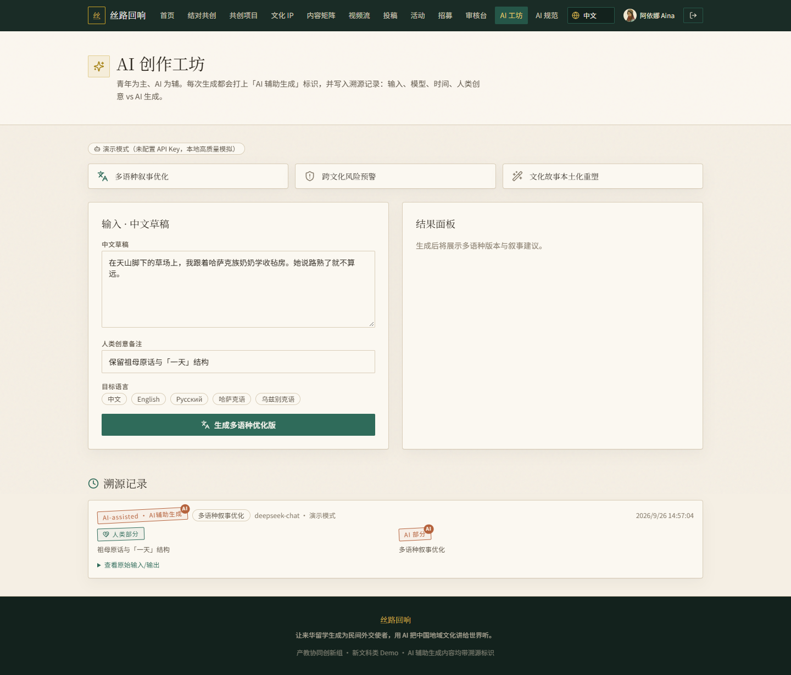
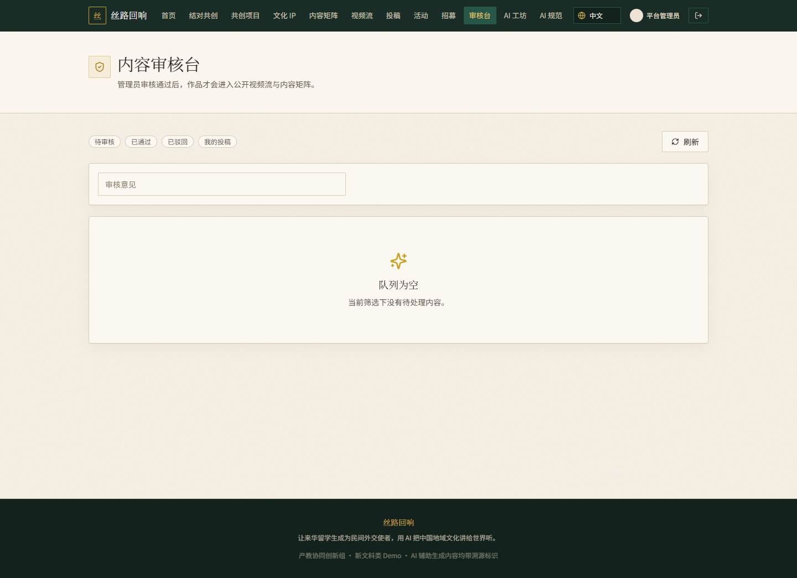
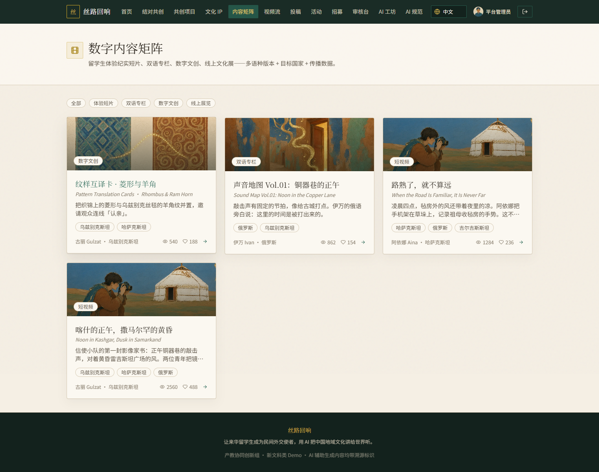
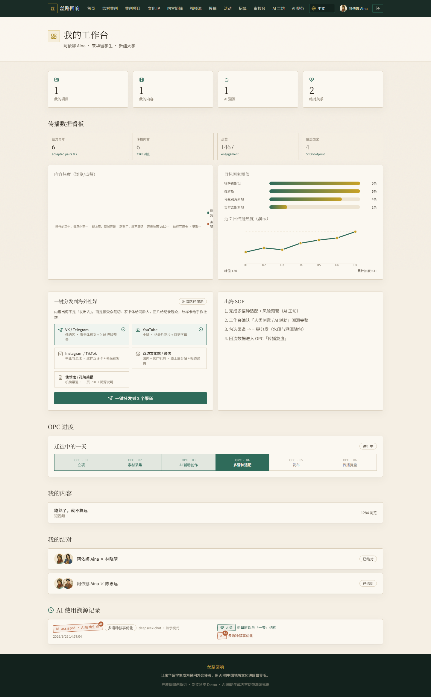
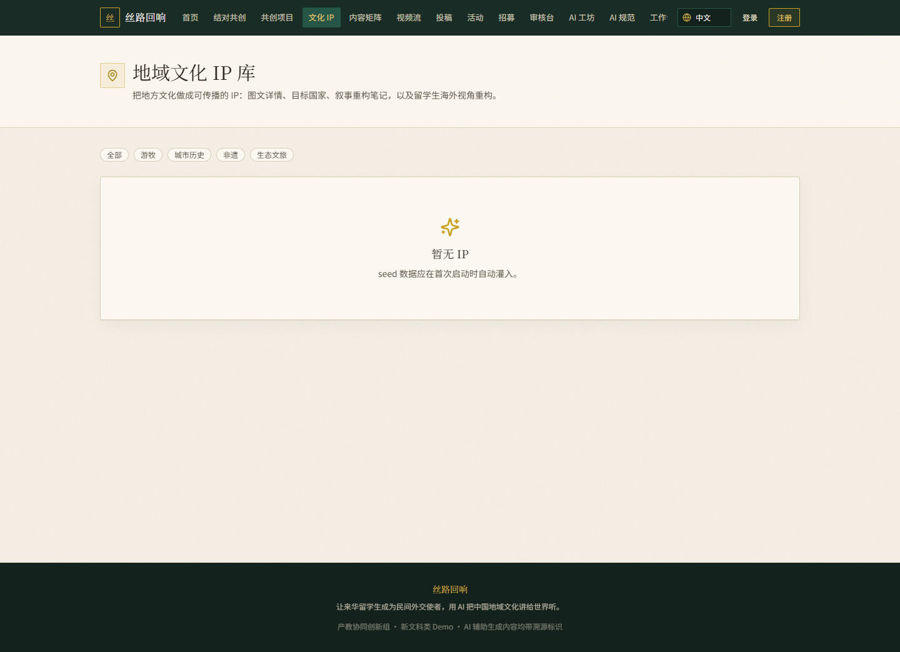

# 丝路回响 · Silk Road Echo

**面向来华留学生的 AI + OPC 跨文化共创与地域文化双向传播平台**
AI + OPC cross-cultural co-creation and two-way regional culture platform for international students in China

> 让来华留学生成为民间外交使者，用 AI 把中国地域文化讲给世界听。

[English](README_EN.md) · [架构](docs/ARCHITECTURE.md) · [权限矩阵](docs/AUTH_MATRIX.md) · [AI 与溯源](docs/AI_PROVENANCE.md) · [验证](docs/VERIFICATION.md) · [演示脚本](docs/DEMO_SCRIPT.md)

> 本仓为**公开展示仓**：产品说明、架构文档、真实运行截图与验证记录。完整源码在私有工程仓 `silk-road-echo`（不公开）。
> 面向岗位定位：**AI 应用工程师 / FDE 校招** —— 端到端产品工程 + 可控 AI 内容治理，而非单纯模型训练或 RAG 堆砌。

---

## 目录

1. [业务问题](#1-业务问题)
2. [技术方案](#2-技术方案)
3. [系统架构](#3-系统架构)
4. [产品截图](#4-产品截图)
5. [已验证成果](#5-已验证成果)
6. [AI 集成与全栈研发记录](#6-ai-集成与全栈研发记录)
7. [权限模型](#7-权限模型)
8. [项目状态](#8-项目状态)
9. [验证范围](#9-验证范围)
10. [已知限制](#10-已知限制)
11. [项目历程与维护记录](#11-项目历程与维护记录)
12. [文档导航与许可](#12-文档导航与许可)

---

## 1. 业务问题

来华留学生与中国学生的跨文化共创，长期缺少一条贯通的链路：

- **创作侧**：结对、立项、采集、创作、适配、发布、复盘缺少一体化的阶段化管理（OPC 六阶段）。
- **内容侧**：多语言（中 / 英 / 俄）视频投稿需要**投稿 → 审核 → 发布**的 UGC 治理，公开流只能展示过审内容。
- **AI 侧**：AI 生成内容需要**可控生成与人机边界**（溯源、风险提示），而不是黑盒输出。
- **传播侧**：站内生产审核完成后分发到海外社媒，**站外播放数据无开放接口可自动拉取**，需要可信的回填与核验链路。

> 作品集定位：相对「纯 RAG / 训练」向项目，本项目补强 **UGC 产品工程、AI 内容治理、业务度量、FDE 式交付**（本地一键演示、边界清晰、可验收）。

## 2. 技术方案

- **全栈交付**：Next.js 14 全栈（App Router + Route Handlers + Prisma）从数据模型到 UI 一次跑通。
- **多角色权限**：JWT Cookie，留学生 / 中国学生 / 导师 / 管理员四类角色。
- **UGC 治理**：投稿 → 审核 → 发布闭环，公开流只展示过审内容。
- **AI 可控生成**：三类工作流 + **真实 API / 无密钥演示模式** 双路径 + 人机双份溯源。
- **多语言**：中 / 英 / 俄界面与内容字段。
- **业务闭环**：站内生产审核 → 海外分发 → **站外播放数据回填与核验**。

### 技术栈

`TypeScript` · `Next.js 14` · `React 18` · `Tailwind CSS` · `Prisma` · `SQLite` · `JWT (jose + bcrypt)` · `OpenAI-compatible AI API` · `lucide-react`

### 关键问题解决案例

- **站外数据接口缺失**：第三方平台无开放播放接口 → 设计「人工回填 — 管理员核验」链路聚合站内外传播数据。
- **无 API Key 可用性**：Live / Demo 双路径，未配置 Key 时走演示模式且**界面明确标注**。
- **越权与内容治理**：JWT 四角色权限矩阵 + 投稿类型 / 大小校验 + 审核状态机控制发布，公开流只展示过审内容。

## 3. 系统架构

详细说明见 [docs/ARCHITECTURE.md](docs/ARCHITECTURE.md)。

### 业务主流程

## 4. 产品截图

> 截图来自本机 `npm run dev` **实测页面，非概念图**。

| | |
| :---: | :---: |
|  |  |
| **首页 · 旗舰 IP 与传播看板** | **竖屏视频流（仅过审内容）** |
|  |  |
| **视频投稿（多语简介）** | **AI 创作工坊 · 三工作流** |
|  |  |
| **管理端审核台** | **作品详情 · 站外传播回流** |
|  |  |
| **数据看板** | **文化 IP 库** |

## 5. 已验证成果

**能力一览**（✅ 已交付并可演示 · ⛔ 明确未做）

| 模块 | 说明 | 状态 |
| --- | --- | --- |
| 认证与角色 | JWT Cookie，4 角色 | ✅ |
| 结对共创 | 发现搭档 / 接受结对 | ✅ |
| 文化 IP | 草原 / 城市 / 非遗 / 生态 + 海外视角 | ✅ |
| OPC 项目 | 立项→采集→创作→适配→发布→复盘 | ✅ |
| 视频 UGC | 上传 mp4/mov/webm ≤80MB | ✅ |
| 审核 | pending / approved / rejected | ✅ |
| Feed | 竖屏播放，仅过审 | ✅ |
| AI 工坊 | 叙事优化 / 风险预警 / 本土化 | ✅ |
| AI 溯源 | AiRecord + UI 水印 | ✅ |
| 站外回流 | 回填 + 核验统计 | ✅ |
| i18n | 中 / 英 / 俄 | ✅ |
| 自动化单测 | — | ⛔ 未做（见 [验证](docs/VERIFICATION.md)） |
| Docker / CI | — | ⛔ 未做 |
| 第三方 API 自动拉数 | — | ⛔ 不可行 / 未接入，采用回填核验 |

完整清单：[docs/FEATURE_CHECKLIST.md](docs/FEATURE_CHECKLIST.md)

## 6. AI 集成与全栈研发记录

### AI：真实调用 vs 演示模式

| 模式 | 条件 | 行为 |
| --- | --- | --- |
| **Live** | 配置 `AI_API_KEY` | 请求 `AI_API_BASE`（OpenAI 兼容 `chat/completions`） |
| **Demo** | 未配置 Key | 规则 + 模板本地生成，**界面标明「演示模式」** |

两种模式都会写入 `AiRecord`（输入、模型、人类创意 / AI 生成、水印）。细节：[docs/AI_PROVENANCE.md](docs/AI_PROVENANCE.md)

### 全栈研发与开发记录

以下**可核验的开发记录**支撑端到端交付叙事（本仓提交历史、文档与实测截图均可追溯）：

- **架构与模型设计**：[docs/ARCHITECTURE.md](docs/ARCHITECTURE.md)（与实现对齐的数据模型、API、AI 双路径）。
- **验证记录**：[docs/VERIFICATION.md](docs/VERIFICATION.md)、[docs/GAP_NOTES.md](docs/GAP_NOTES.md)——包含已验证项与未做项的逐条说明。
- **真实运行截图**：[第 4 节](#4-产品截图) 全部来自本机 `npm run dev` 实测界面。
- **业务落地链路**：主流程覆盖站内生产审核 → 海外分发 → 站外回填核验（见 [业务主流程](#3-系统架构)）。
- 完整源码与工程开发历史保存在**私有工程仓**；本仓不复制私有代码，不以截图冒充代码或测试记录。

## 7. 权限模型

| 能力 | 学生 | 导师/管理员 |
| --- | --- | --- |
| 浏览公开内容 | ✅ | ✅ |
| 投稿上传 | ✅ | ✅ |
| 审核队列 / 通过驳回 | ❌ | ✅ |
| 核验站外数据 | ❌ | ✅ |
| 修改本人项目 | ✅ | ✅（含跨项目） |

完整矩阵：[docs/AUTH_MATRIX.md](docs/AUTH_MATRIX.md)

## 8. 项目状态

| 项 | 状态 |
| --- | --- |
| 公开展示仓（本文档、架构/权限/验证文档、实测截图） | ✅ 完成并持续维护 |
| 产品功能主链路（认证、结对、投稿、审核、Feed、AI 工坊、回流、i18n） | ✅ 可本地演示 |
| 自动化测试 / Docker / CI | ⛔ 未做（不作通过宣称） |
| 站外平台开放数据接口 | ⛔ 不可行 / 未接入，采用人工回填 + 管理员核验 |
| 完整源码 | 🔒 私有工程仓 `silk-road-echo` |

## 9. 验证范围

- **截图**：本机 `npm run dev` 实测页面，非概念图；演示数据为 seed 虚构账号（如 `demo1234`），不含真实个人隐私。
- **未做项**：自动化单测、Docker / CI、第三方 API 自动拉数——均在 [能力一览](#5-已验证成果) 中显式标注 ⛔，不以规划充当已交付。
- **AI 输出**：Live / Demo 双模式行为与溯源口径见 [docs/AI_PROVENANCE.md](docs/AI_PROVENANCE.md)；无 API Key 时走演示模式，界面明确标注。

## 10. 已知限制

- 本仓**不含**源码、密钥与数据库：公开仓仅文档、截图与验证材料（仓库关系见 [项目状态](#8-项目状态)）。
- 演示账号与内容为 **seed 虚构数据**，不代表真实用户与真实传播效果。
- **Star 与浏览量不代表用户数或国际传播规模**；站外传播数字以回填核验口径为准。
- 第三方平台数据接口受限，站外播放数据依赖**人工回填 + 管理员核验**，非自动同步。
- 展示仓文档可查阅；**完整源码以私有仓库授权为准**（见 [文档导航与许可](#12-文档导航与许可)）。

## 11. 项目历程与维护记录

- **原始开发**：2026.06—至今，跨文化共创与传播平台的全栈研发与本机实测。
- **2026 年 10 月**：GitHub 公开展示整理——README、架构 / 权限 / 验证文档与 8 屏实测截图公开（自 2026-10-21 起提交）。
- **AI Coding Agent 记录说明**：本仓公开提交历史与文档中**未见 Codex / AI 编码工具记录**，因此不作此类宣称；后续如有真实记录再据实补充。
- **后续**：完整源码与开发历史在私有工程仓，**Git 提交时间未做改写**。

## 12. 文档导航与许可

| 文档 | 内容 |
| --- | --- |
| [docs/ARCHITECTURE.md](docs/ARCHITECTURE.md) | 架构与数据模型（与实现对齐） |
| [docs/BUSINESS_FLOW.md](docs/BUSINESS_FLOW.md) | 业务流程 |
| [docs/AUTH_MATRIX.md](docs/AUTH_MATRIX.md) | 权限矩阵 |
| [docs/AI_PROVENANCE.md](docs/AI_PROVENANCE.md) | AI 双模式与溯源 |
| [docs/VERIFICATION.md](docs/VERIFICATION.md) | 验证记录与未做项 |
| [docs/GAP_NOTES.md](docs/GAP_NOTES.md) | 差距与说明 |
| [docs/FEATURE_CHECKLIST.md](docs/FEATURE_CHECKLIST.md) | 功能清单 |
| [docs/DEMO_SCRIPT.md](docs/DEMO_SCRIPT.md) | 演示脚本 |

**许可**：展示仓文档可查阅；完整源码以私有仓库授权为准。第三方数据接口与模型的使用须遵守其各自条款。
