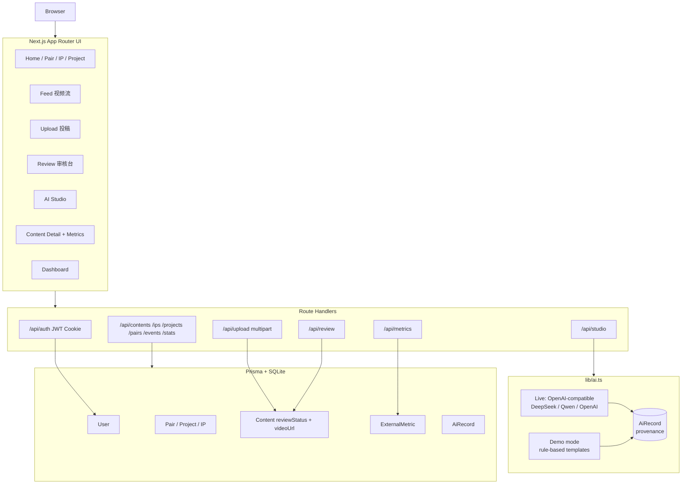
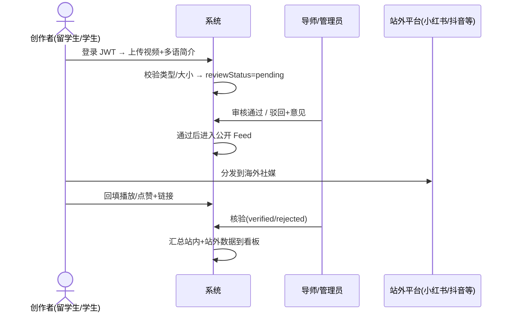

# 丝路回响 · Silk Road Echo

**面向来华留学生的 AI + OPC 跨文化共创与地域文化双向传播平台**  
AI + OPC cross-cultural co-creation and two-way regional culture platform for international students in China

> 让来华留学生成为民间外交使者，用 AI 把中国地域文化讲给世界听。  
> Let international students become people-to-people ambassadors — use AI to tell China's regional stories to the world.

[English](./README_EN.md) · 能力清单 · [架构](./docs/ARCHITECTURE.md) · [权限矩阵](./docs/AUTH_MATRIX.md) · [AI 与溯源](./docs/AI_PROVENANCE.md) · [验证](./docs/VERIFICATION.md) · [演示脚本](./docs/DEMO_SCRIPT.md)

---

## 定位（面向 AI 应用工程师 / FDE 校招）

本项目强调 **端到端产品工程 + 可控 AI 内容治理**，而非单纯模型训练或 RAG 堆砌：

- **全栈交付**：Next.js 14 全栈（App Router + Route Handlers + Prisma）从数据模型到 UI 一次跑通  
- **多角色权限**：JWT Cookie，留学生 / 中国学生 / 导师 / 管理员  
- **UGC 治理**：投稿 → 审核 → 发布闭环，公开流只展示过审内容  
- **AI 可控生成**：三类工作流 + **真实 API / 无密钥演示模式** 双路径 + 人机双份溯源  
- **多语言**：中 / 英 / 俄界面与内容字段  
- **业务闭环**：站内生产审核 → 海外分发 → **站外播放数据回填与核验**

---

## 产品截图（本地真实运行界面）

| | |
|:--:|:--:|
|  |  |
| 首页 · 旗舰 IP 与传播看板 | 竖屏视频流（仅过审内容） |
|  |  |
| 视频投稿（多语简介） | AI 创作工坊三工作流 |
|  |  |
| 管理端审核台 | 作品详情 · 站外传播回流 |

> 截图来自本机 `npm run dev` 实测页面，非概念图。

---

## 系统架构（与实现对齐）

详细说明见 [docs/ARCHITECTURE.md](./docs/ARCHITECTURE.md)。

---

## 业务主流程

---

## 能力一览

| 模块 | 说明 | 状态 |
|------|------|------|
| 认证与角色 | JWT Cookie，4 角色 | ✅ |
| 结对共创 | 发现搭档 / 接受结对 | ✅ |
| 文化 IP | 草原/城市/非遗/生态 + 海外视角 | ✅ |
| OPC 项目 | 立项→采集→创作→适配→发布→复盘 | ✅ |
| 视频 UGC | 上传 mp4/mov/webm ≤80MB | ✅ |
| 审核 | pending/approved/rejected | ✅ |
| Feed | 竖屏播放，仅过审 | ✅ |
| AI 工坊 | 叙事优化 / 风险预警 / 本土化 | ✅ |
| AI 溯源 | AiRecord + UI 水印 | ✅ |
| 站外回流 | 回填 + 核验统计 | ✅ |
| i18n | 中 / 英 / 俄 | ✅ |
| 自动化单测 | — | ❌ 未做（见 VERIFICATION） |
| Docker / CI | — | ❌ 未做 |
| 第三方 API 自动拉数 | — | ❌ 不可行/未接入，采用回填核验 |

完整清单：[docs/FEATURE_CHECKLIST.md](./docs/FEATURE_CHECKLIST.md)

---

## 技术栈

`TypeScript` · `Next.js 14` · `React 18` · `Tailwind CSS` · `Prisma` · `SQLite` · `JWT (jose + bcrypt)` · `OpenAI-compatible AI API` · `lucide-react`

---

## AI：真实调用 vs 演示模式

| 模式 | 条件 | 行为 |
|------|------|------|
| **Live** | 配置 `AI_API_KEY` | 请求 `AI_API_BASE`（OpenAI 兼容 `chat/completions`） |
| **Demo** | 未配置 Key | 规则+模板本地生成，**界面标明「演示模式」** |

两种模式都会写入 `AiRecord`（输入、模型、人类创意 / AI 生成、水印）。  
细节：[docs/AI_PROVENANCE.md](./docs/AI_PROVENANCE.md)

---

## 权限（摘要）

| 能力 | 学生 | 导师/管理员 |
|------|------|-------------|
| 浏览公开内容 | ✅ | ✅ |
| 投稿上传 | ✅ | ✅ |
| 审核队列 / 通过驳回 | ❌ | ✅ |
| 核验站外数据 | ❌ | ✅ |
| 修改本人项目 | ✅ | ✅（含跨项目） |

完整矩阵：[docs/AUTH_MATRIX.md](./docs/AUTH_MATRIX.md)

---

## 仓库说明（安全）

| 仓库 | 可见性 | 内容 |
|------|--------|------|
| `silk-road-echo` | **Private** | 完整源码、schema、seed、本地运行脚本 |
| `silk-road-echo-intro` | **Public** | 产品展示、架构说明、截图、验证与演示稿（**无源码 / 无密钥 / 无数据库**） |

演示数据为 seed 虚构账号（如 `demo1234`），不含真实个人隐私。

---

## 能力互补（作品集叙事）

相对「纯 RAG / 训练」向项目，本项目补强：

1. **UGC 产品工程**：上传、审核、信息流、多角色  
2. **AI 内容治理**：溯源、人机边界、风险工作流  
3. **业务度量**：站内外传播数据口径与核验  
4. **FDE 式交付**：本地一键演示、边界清晰、可验收  

---

## License

展示仓库文档可查阅；完整源码以私有仓库授权为准。
