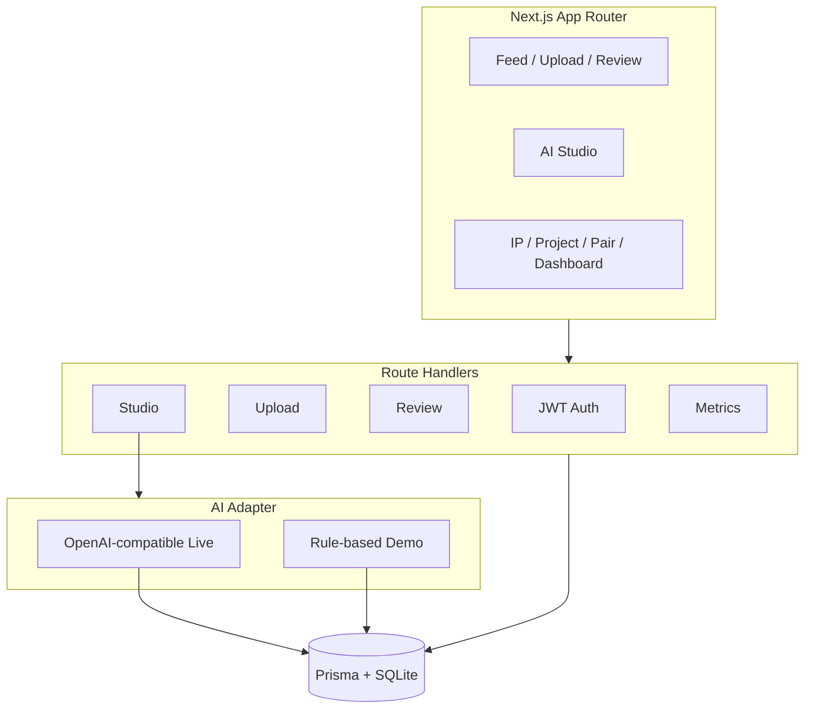

# Silk Road Echo

**AI + OPC cross-cultural co-creation and two-way regional culture platform for international students in China**

> Let international students become people-to-people ambassadors — use AI to tell China's regional stories to the world.

Chinese README: [README.md](./README.md)

---

## Positioning (AI Application Engineer / FDE portfolio)

This project is **not** a generic RAG demo or model-training showcase. It emphasizes:

1. **End-to-end product engineering** — Next.js full-stack from schema to UI  
2. **Multi-role access control** — JWT cookies for four personas  
3. **UGC governance** — upload → moderation → public feed  
4. **Controllable AI generation** — three workflows + live/demo dual path + provenance  
5. **i18n** — Chinese / English / Russian  
6. **Business metrics** — off-platform reach backfill and admin verification  

---

## Screenshots (real local UI)

| | |
|:--:|:--:|
|  |  |
| Home & flagship IP | Vertical feed (approved only) |
|  |  |
| Video upload | AI studio |
|  |  |
| Admin review desk | Content + external reach panel |

Captured from a live `npm run dev` instance — not mockups.

---

## Architecture

See [docs/ARCHITECTURE.md](./docs/ARCHITECTURE.md) and [docs/BUSINESS_FLOW.md](./docs/BUSINESS_FLOW.md).

---

## Capability matrix

| Capability | Status |
|------------|--------|
| JWT auth, 4 roles | Implemented |
| Pairing / Culture IP / OPC projects | Implemented |
| Video upload (mp4/mov/webm ≤80MB) | Implemented |
| Moderation pending / approved / rejected | Implemented |
| Public vertical feed | Implemented |
| AI studio (narrative / risk / localize) | Implemented |
| AI provenance (`AiRecord` + watermark) | Implemented |
| Off-platform metrics backfill + verify | Implemented |
| i18n zh / en / ru | Implemented |
| Unit tests / Docker / CI | **Not implemented** |
| Auto-fetch Xiaohongshu APIs | **Not implemented** (backfill+verify by design) |

---

## AI: Live vs Demo

| Mode | Trigger | Behavior |
|------|---------|----------|
| Live | `AI_API_KEY` set | OpenAI-compatible `chat/completions` |
| Demo | no key | Rule/template results, UI labels **演示模式 / Demo mode** |

Both paths write `AiRecord` (input, model, human vs AI parts, watermark). Details: [docs/AI_PROVENANCE.md](./docs/AI_PROVENANCE.md)

---

## Security & scope of this repo

- **This public repo** = product docs, diagrams, screenshots, verification notes, demo script.  
- **Private repo `silk-road-echo`** = source code (available on request).  
- No secrets, no database dumps, no real personal data, no proprietary media.

---

## Verification

`npm run build` and API smoke results: [docs/VERIFICATION.md](./docs/VERIFICATION.md)
