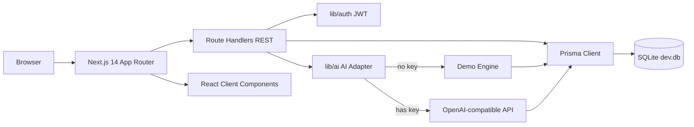
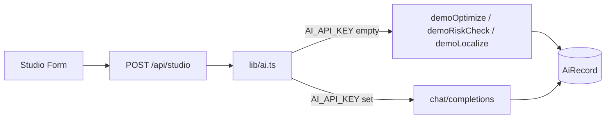

# 系统架构 System Architecture

> 与私有仓实现一一对齐；公开仓不包含源码。

## 1. 分层结构

## 2. 前端路由（UI）

| 路由 | 职责 |
|------|------|
| `/` | 品牌首页、旗舰 IP、传播看板 |
| `/pair` `/projects` `/ips` | 结对、OPC 项目、文化 IP |
| `/feed` | 竖屏视频流（仅 `reviewStatus=approved`） |
| `/upload` | 视频投稿（登录后） |
| `/review` | 审核台（mentor/admin） |
| `/studio` | AI 三工作流 + 溯源 |
| `/contents/[id]` | 播放器 + 多语 + 站外回流面板 |
| `/dashboard` `/events` `/recruit` `/governance` | 工作台 / 活动 / 招募 / AI 规范 |
| `/login` `/register` | 认证 |

## 3. API 面（节选）

| Method | Path | 说明 |
|--------|------|------|
| POST | `/api/auth/login` `/register` `/logout` | JWT Cookie |
| GET | `/api/auth/me` | 会话 |
| GET/POST | `/api/upload` | multipart 视频上传 |
| GET/PATCH | `/api/review` | 审核队列与通过/驳回 |
| POST | `/api/studio` | AI 工作流（写 AiRecord） |
| GET/POST | `/api/metrics` | 站外回流 / 核验 |
| GET/POST/PATCH | `/api/contents` `projects` `pairs` `ips` `events` | 业务 CRUD |
| GET | `/api/stats` | 站内 + 站外汇总 |

## 4. 数据模型（10）

`User` `Pair` `IP` `Project` `ProjectMember` `Content` `ExternalMetric` `Event` `EventRegistration` `AiRecord`

关键字段：

- `Content.reviewStatus`: `pending | approved | rejected`
- `Content.videoUrl`: 本地 `/uploads/videos/*`
- `ExternalMetric.verifyStatus`: `pending | verified | rejected`
- `AiRecord`: workflow / input / output / model / humanPart / aiPart / watermark

## 5. AI 适配层

## 6. 部署形态

- **当前交付**：本地 `npm run db:setup && npm run dev`（SQLite 零外依）
- **生产可选**：PostgreSQL（改 Prisma provider + `DATABASE_URL`）
- **未做**：Docker 多服务编排、CDN、视频转码、K8s
